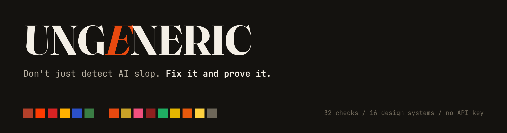
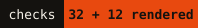
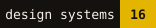
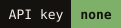
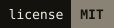
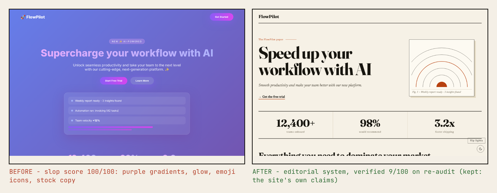
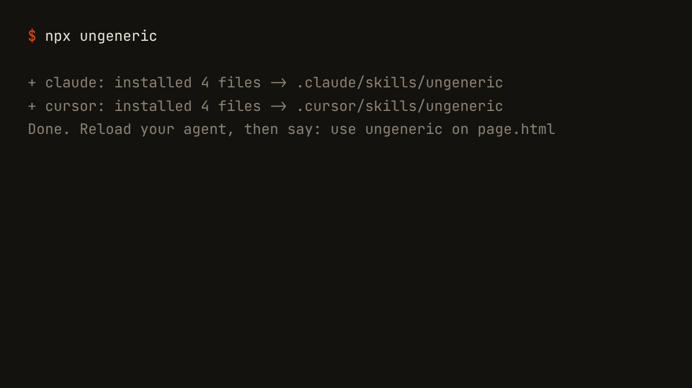
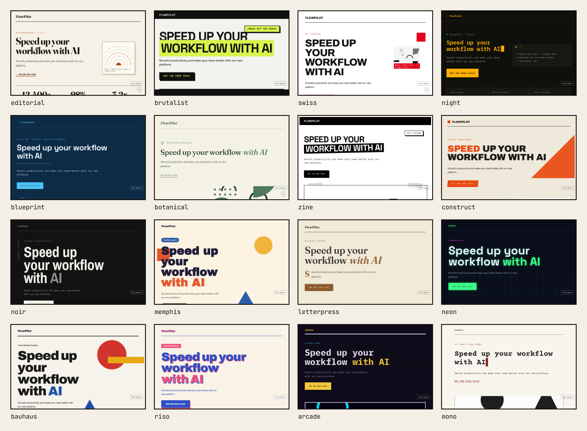

<p align="center">
  
</p>

<p align="center">
  
  
  
  
  
</p>

<p align="center">
  <a href="https://saladi-siddharth.github.io/ungeneric/landing/"><b>🌐 Website: saladi-siddharth.github.io/ungeneric/landing</b></a>
</p>

A skill for your coding agent that turns vibecoded, AI-looking UI into designed UI. Free, local, no account, no API key.

Say **"use ungeneric"** in Claude Code, Cursor, Codex, Google Antigravity, VS Code (Copilot), Gemini CLI or OpenCode, and the agent audits your page on 32 slop checks, rebuilds it with one of sixteen real design systems, then re-audits the result to prove the fix.

<p align="center">
  
</p>

## Install

One command, from any project folder:

```bash
npx --yes github:saladi-siddharth/ungeneric
```

It detects which coding agents you use and installs the skill into each one's skills folder. Pick agents or install globally:

```bash
npx --yes github:saladi-siddharth/ungeneric --agents=claude,cursor   # pick agents
npx --yes github:saladi-siddharth/ungeneric --all                    # every known agent
npx --yes github:saladi-siddharth/ungeneric --global --agents=claude # available in every project
```

Or from a local clone: `node skill/ungeneric/install.mjs` (same flags).

| Agent | Project install | Global install | Invoke |
| --- | --- | --- | --- |
| Claude Code | `.claude/skills/ungeneric/` | `~/.claude/skills/ungeneric/` | `/ungeneric` |
| Cursor | `.cursor/skills/ungeneric/` | `~/.cursor/skills/ungeneric/` | `/ungeneric` |
| Codex CLI | `.agents/skills/ungeneric/` | `~/.agents/skills/ungeneric/` | `$ungeneric` |
| Google Antigravity | `.agents/skills/ungeneric/` (shared with Codex) | `~/.gemini/config/skills/ungeneric/` | `/ungeneric` |
| GitHub Copilot / VS Code | `.github/skills/ungeneric/` | `~/.copilot/skills/ungeneric/` | `/ungeneric` in chat |
| Gemini CLI | `.gemini/skills/ungeneric/` | `~/.gemini/skills/ungeneric/` | "use ungeneric" |
| OpenCode | `.opencode/skills/ungeneric/` | | `/ungeneric` |

Reload the agent after installing. Then: **"use ungeneric on index.html"**.

<p align="center">
  
</p>

## Sixteen design systems, one command each

Every tile below is the same vibecoded page, rebuilt by a different system. Your content and links survive; the layout, type, palette and motion do not.

<p align="center">
  
</p>

## No agent? One command line

```bash
node cli.mjs page.html -d swiss -o clean.html
```

Works on local files and live URLs. `--polish` keeps the design and strips only the tells. `--json` for machine-readable audits. `--directions` lists the library. `--max-score N` exits 2 above N, a CI gate. `--render` adds a headless-Chromium pass that measures computed styles, and `--annotate report.png` writes a full-page screenshot with numbered markers on every blamed element.

## Optional: the local web tool

`index.html` is a self-contained page you can open straight from disk (fonts self-hosted, works offline): paste HTML, watch the audit, get the rebuild with before/after on desktop and phone, a wipe slider, click-to-edit, share cards, and a style-from-screenshot mode. It is a local file, not a hosted service.

## What the audit checks

32 source checks - purple gradients, gradient text, glow shadows, emoji icons, default fonts, stock marketing copy, generic heroes, card grids, pill radii, color soup, missing alt text, looping animations, transition-all, hover:scale, tracked-caps labels, greeting headlines, exclamation headlines, sparkle badges, "AI-powered" copy, off-grid spacing, dead links, missing reduced-motion, removed focus outlines, template leaks, glass surfaces, blob shapes, Tailwind violet, middot meta strings, invented proof stats, nested cards, fake window chrome - plus 12 rendered computed-style checks with `--render` (real font stacks, tiny text, shadow soup, single-radius templates, low-contrast text, looping motion, flat type scales, stranded heading words and more). `.jsx`, `.tsx`, `.vue`, `.svelte` and `.astro` sources are normalized and audited for the markup they render.

## What the rebuild does

- **Restyle**: strips gradients/glows/default fonts, rewrites stock copy at phrase level, replaces emoji with a hand-drawn line-icon set, normalizes layout and spacing, applies a full design system with a real motion layer. Honors prefers-reduced-motion.
- **Recompose (layout rebuild)**: for heavy-slop pages, Ungeneric extracts the page's content (headline, sub, CTAs, stats, features, images) and rebuilds it into a composed layout - full-bleed hero, stats ledger, numbered feature rows, terminal readouts, zine collages, giant footer wordmark. New structure, same words. Photo slots use the page's own images, or original seeded SVG artwork in the direction's palette - no stock photos, no external URLs. Includes a cursor-reactive WebGL hero shader and a pinned scroll-driven 3D scene, vanilla WebGL, no dependencies.
- **Verified fix loop**: every rebuild is re-audited and the CLI exits non-zero if the output did not improve. If it is not measurably better, it does not ship. Content claims (your stats, your words) are kept by design and reported as such.
- **Directions library**: 16 built-in systems (editorial, brutalist, swiss, night, blueprint, botanical, zine, construct, noir, memphis, letterpress, neon grid, bauhaus, riso print, arcade, manuscript). A direction is one shareable JSON file: `{ id, name, hint, author, fonts, css, swatches }` - see `directions/`.

## How it compares

Fair view of the unslop field, from each tool's own docs and source:

| | Ungeneric | uislop | sloplint | Impeccable | Anthropic frontend-design |
| --- | --- | --- | --- | --- | --- |
| What it is | Skill + engine: audit, deterministic rebuild, re-audit proof | Detector CLI | Detector skill | Steering skill for the model + detector | Steering skill for generating new UI |
| Audits an existing page | 32 source + 12 rendered checks | ~16 tells | ~54 tells | Yes (detector) | No, guidance only |
| Rebuilds the page for you | Yes - 16 design systems, keeps your content and links | No | No | No, steers the model's rewrite | Generates new UI from a prompt; does not rebuild an existing page |
| Proves the fix | Yes - re-audit loop, refuses to ship a worse score | No | No | No | Model self-critique, where the environment allows screenshots |
| Needs a model / API | No | No | No | Yes | Yes |
| Works offline | Yes | Yes | Yes | No | No |
| Agents | 7 coding agents + CLI + local web tool | CLI | Claude-oriented | Many, via npx install | Claude Code |

Where Ungeneric wins: it is the only one that rebuilds the page itself and then proves the fix with a second audit - detection without a fix is homework. It is deterministic (same input, same output, diffable in CI), free, offline, and works in the most agents.

Where the others win, honestly:

- **Creative range.** Impeccable and frontend-design steer a model, so they can invent a bespoke direction per brief. Ungeneric picks from 16 fixed design systems - predictable and testable, but bounded. For a net-new page from a blank prompt, a steering skill is the better tool; Ungeneric is for fixing pages that already exist.
- **Detection breadth.** sloplint tracks more raw tells. Ungeneric implements the high-signal ones and documents the few it rejects on principle (rules that would forbid a whole legitimate aesthetic, like neon-on-dark).
- **Nuance.** A model judges intent; heuristics cannot. Ungeneric's source checks can false-positive on unusual but intentional markup, and its score is a heuristic, not a verdict.

## Honest scope

It does not generate images, edit source components, or call any paid service. The slop score is a heuristic - a conversation starter, not a judgment. Source checks are text heuristics and can false-positive on unusual but intentional markup. The engine's own output is held to the same standard: all sixteen directions pass every check, with documented disagreements only where a generic rule would gut a direction's identity.

**Field-tested**: the recompose engine has been run against 20 real public sites (SaaS, restaurants, blogs, schools, clinics, news) - extraction fallbacks, entity decoding, image-chrome filtering and broken-image art fallback all came out of that test.

## Repo structure

```
skill/ungeneric/   the agent skill: SKILL.md + engine + CLI + installer (what npx installs)
engine.js          the audit (32 checks), 16 design systems, extraction and rebuild pipeline
render-audit.mjs   rendered computed-style audit (12 checks) + annotated report screenshots
cli.mjs            the command line: audit, rebuild, polish, verify, CI gate
index.html         optional local web tool (opens from disk, works offline)
directions/        the 16 design systems as shareable JSON
pr-bot/            local PR audit bot (makes no network calls)
test/smoke.mjs     the smoke suite - run it before touching the engine
docs/media/        README art, all original
```

## Contributing and license

See [CONTRIBUTING.md](CONTRIBUTING.md). MIT - see [LICENSE](LICENSE).
